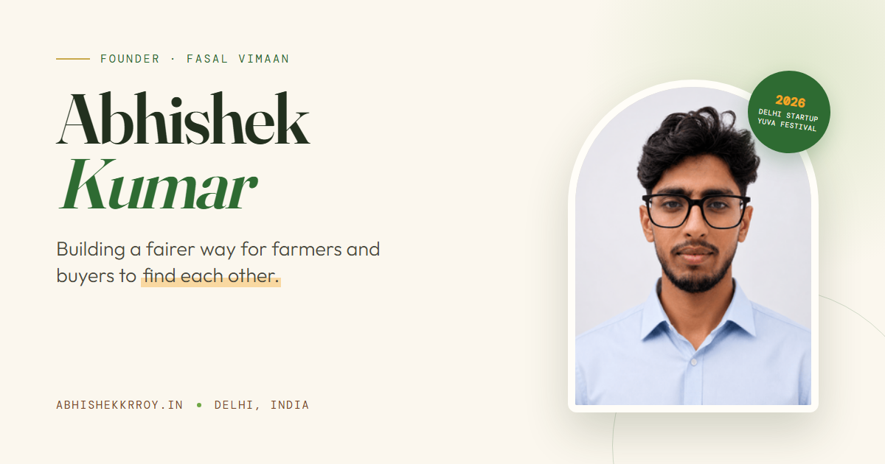

# Abhishek Kumar — Founder, Fasal VIMAAN

Personal portfolio for **Abhishek Kumar**, founder of [Fasal VIMAAN](https://fasalvimaan.com) — a digital
platform connecting farmers and genuine buyers. Built around field research across Bihar, Uttar Pradesh,
Himachal Pradesh and Odisha, plus showcases at YUKTI and the Delhi Startup Yuva Festival 2026.

**Live:** https://abhishekkrroy.in



## Highlights

- Full-bleed hero with the founder portrait and personal introduction
- Feature block for the Delhi CM's visit to the Fasal VIMAAN stall at DSYF 2026
- Field-footprint map covering 11 districts visited on the ground
- Photo archive and 9:16 clip deck with lazy-loaded video, poster frames and an accessible lightbox
- Recognition timeline: YUKTI Regional Meet, Campus to Market Top 100 (₹1 lakh support), DSYF 2026 Top 60
- Direct contact via WhatsApp and LinkedIn, plus an on-page contact form (Web3Forms)
- Responsive from 320 px to 1440 px with reduced-motion support

## Tech stack

- React 19 + TypeScript 5.7
- Vite 8
- Tailwind CSS v4 (`@tailwindcss/vite`) with custom CSS in `src/index.css`
- Web3Forms for the contact form (client-side submission)
- Fraunces, Outfit and DM Mono via Google Fonts

## Getting started

Requires Node.js 22+.

```bash
npm install
npm run dev      # http://localhost:4173
npm run build    # production build in dist/
npm run preview  # serve the production build
npm run format   # oxfmt
```

## Environment variables

The contact form needs a Web3Forms access key. Create `.env` from `.env.example`:

```env
VITE_WEB3FORMS_ACCESS_KEY=your-web3forms-access-key
```

`.env` is git-ignored. `VITE_` variables are embedded into the client bundle at build time, so the key
is public by design — set it in your hosting provider as well, and rotate it in the Web3Forms dashboard
if it is ever abused.

## Deploying to Vercel

| Setting | Value |
| --- | --- |
| Framework | Vite |
| Build command | `npm run build` |
| Output directory | `dist` |

Add `VITE_WEB3FORMS_ACCESS_KEY` under **Settings → Environment Variables** for Production, Preview and
Development, then trigger a fresh deployment. Environment variables only apply to builds created after
they are saved.

## Project structure

```text
index.html              HTML shell, SEO and social metadata
src/
  App.tsx               Page sections and content
  ConnectDialog.tsx     Contact form and email dialog
  Gallery.tsx           Photo archive and clip deck
  FieldMap.tsx          District map
  index.css             Design tokens, layout and responsive styles
  assets/media/         Optimised photos, posters and clips
public/
  assets/               Portrait, farm photos and social preview
  robots.txt
  sitemap.xml
```

## Media

Photographs and clips are optimised copies of the originals; full-quality source files are kept outside
the repository. Video bytes load only when a clip is opened, so the page stays light on mobile data.

## Contact

- Website: [fasalvimaan.com](https://fasalvimaan.com)
- Email: [abhishek@fasalvimaan.com](mailto:abhishek@fasalvimaan.com)
- WhatsApp: [+91 93154 41937](https://wa.me/919315441937)
- LinkedIn: [linkedin.com/in/abhishek-kumar-br851215](https://www.linkedin.com/in/abhishek-kumar-br851215/)

---

© 2026 Abhishek Kumar. All rights reserved.
